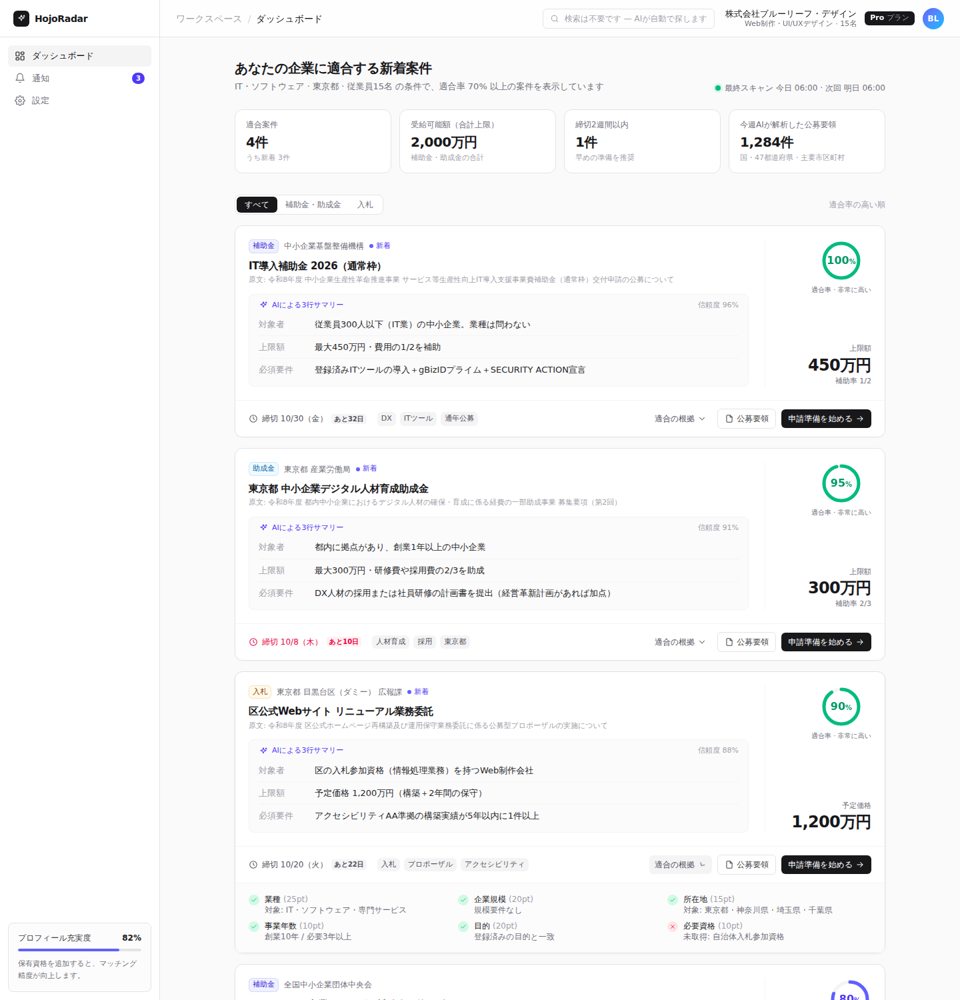

# HojoRadar — 補助金・入札 自動マッチング SaaS（MVP モック）

官公庁の補助金・入札情報を自動収集し、AI が公募要領を要約、登録済みの企業プロフィールと照合して適合案件だけを表示するダッシュボードのモックです。



## 起動

```bash
cd grant-matcher
npm install
npm run dev   # http://localhost:5173
```

## 構成

| ファイル | 内容 |
| --- | --- |
| `src/types.ts` | Step 1: `CompanyProfile` / `GrantItem`（+ `GrantMatch`）の型定義 |
| `supabase/schema.sql` | 型に対応する Supabase テーブル定義と RLS |
| `src/data/mockData.json` | Step 2: 企業プロフィール（Web制作・15名）と AI 要約済み案件 4 件 |
| `src/Dashboard.tsx` | Step 3: ダッシュボード 1 画面（React + Tailwind CSS） |

## 適合率の算出

`Dashboard.tsx` の `evaluateMatch()` が、AI が抽出した `eligibility`（構造化済み要件）と企業プロフィールを比較して算出します。

| 項目 | 配点 |
| --- | --- |
| 業種 | 25 |
| 企業規模（従業員数・資本金） | 20 |
| 目的 | 20 |
| 所在地 | 15 |
| 事業年数 | 10 |
| 必要資格（取得割合で部分点） | 10 |

企業の `notify_threshold`（既定 70%）以上の案件のみ表示・通知します。本番では Edge Function で計算して `grant_matches` に保存する想定です。

> 収録データはすべてダミーです（URL は `example.*`、金額・締切は架空）。
