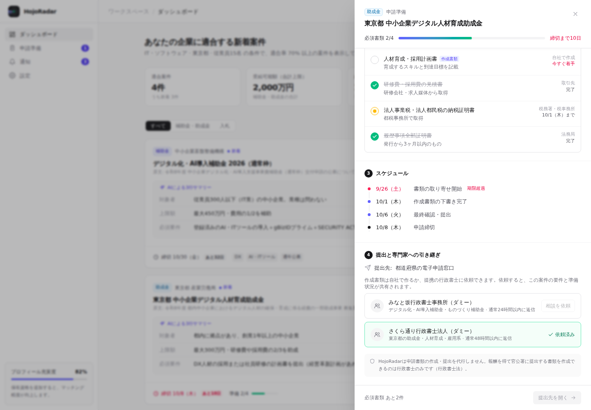

# HojoRadar — 補助金・入札の自動マッチングと申請準備（MVP モック）

官公庁の補助金・入札情報を自動収集し、AI が公募要領を要約、登録済みの企業プロフィールと照合して適合案件だけを表示します。
適合した案件は **申請準備（必要書類・逆算スケジュール）まで自動化** し、書類作成が必要な場面では **提携行政書士へ引き継ぎ** ます。

> HojoRadar は申請書類の作成・提出を代行しません。報酬を得て官公署に提出する書類を作成できるのは行政書士のみです（改正行政書士法, 2026年1月施行）。

| ダッシュボード | 申請準備パネル |
| --- | --- |
|  |  |

## 起動

```bash
cd grant-matcher
npm install
npm run dev   # http://localhost:5173
```

## 構成

```
src/
  types.ts                 ドメイン型（Supabase の行型と対応）
  data/mockData.json       企業・案件・提携事務所・申請準備のダミーデータ
  lib/
    data.ts                データ読み込みと適合判定（モジュール読み込み時に 1 回）
    matching.ts            適合率の算出と、未充足要件への対応策
    format.ts / labels.ts  日付・金額の整形、表示ラベル
  components/
    Layout.tsx             サイドバー・ヘッダー
    GrantCard.tsx          案件カード（AI 3行サマリー・適合率・上限額）
    PrepDrawer.tsx         申請準備パネル（要件確認 → 必要書類 → スケジュール → 提出・引き継ぎ）
    LiveScan.tsx           AI 解析中ティッカー
    motion.tsx             カウントアップ・適合率リング・レーダーロゴ
    icons.tsx
  Dashboard.tsx            画面の組み立てと状態管理
supabase/schema.sql        テーブル定義と RLS
```

## 申請準備ワークフロー

1. **要件の最終確認** — 適合判定で満たしていない要件と、取るべき行動を表示
2. **必要書類** — 公募要領から AI が抽出。入手先と所要日数から着手期限を逆算し、期限超過は赤で警告
3. **スケジュール** — 取り寄せ開始・下書き完了・最終確認・締切のマイルストーン
4. **提出と引き継ぎ** — 提出先（jGrants 等）の案内と、提携行政書士への相談依頼（入札は自社作成のため対象外）

## 適合率の算出

`lib/matching.ts` の `evaluateMatch()` が、AI が抽出した `eligibility` と企業プロフィールを比較します。

| 項目 | 配点 |
| --- | --- |
| 業種 | 25 |
| 企業規模（従業員数・資本金） | 20 |
| 目的 | 20 |
| 所在地 | 15 |
| 事業年数 | 10 |
| 必要資格（取得割合で部分点） | 10 |

企業の `notify_threshold`（既定 70%）以上の案件のみ表示・通知します。本番では Edge Function で計算して `grant_matches` に保存する想定です。

## モーションとパフォーマンス

- [Motion](https://motion.dev) を `LazyMotion` + `m` コンポーネントで使用（未使用機能をバンドルしない）
- OS の「視差効果を減らす」設定を尊重（`MotionConfig reducedMotion="user"`）
- 数値のカウントアップは再レンダーせず DOM テキストのみ更新
- 静的データの適合判定・集計はモジュールスコープで 1 回だけ計算

> 収録データはすべてダミーです（URL は `example.*`、金額・締切・事務所名は架空）。表示を安定させるため「今日」は 2026/9/29 に固定しています。
